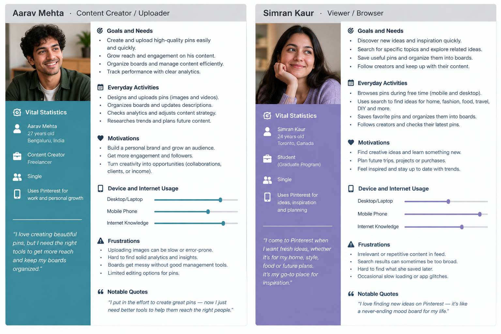

## Personas

## User Persona_1 — Design Explorer

### Persona: Priya Sharma

- Age: 24
- Occupation: Graphic Designer
- Technical Experience: Comfortable with mobile and web applications

### What does she want to do?

Priya wants a platform to discover creative ideas and find inspiration for her work and personal projects.

She wants to:

- Discover design inspiration quickly.
- Search for specific ideas such as logos, UI designs, posters, and color palettes.
- Save interesting pins for later.
- Organize them somewhere in app.
- Follow designers whose work she likes.
- Like and comment on interesting designs.
- Find new creators with similar interests.

### What frustrates her?

- Finding relevant content can take too long.
- Search results may contain too much irrelevant content.
- Saving images design can become difficult to organize.
- It can be difficult to discover new creators and design with similar interests.

### Goal

Priya wants to quickly discover useful creative ideas, save and organize them efficiently, and interact with creators who share her interests.

## User Persona_2 — Content Creator

### Persona: Aarav Mehta

- Age: 26
- Occupation: Freelance Graphic Designer
- Technical Experience: Comfortable with social media and design tools

### What does he want to do?

Rahul wants a platform to showcase his creative work and reach people who are interested in design.

He wants to:

- Upload and share his designs.
- Organize his designs.
- Reach new users and grow his audience.
- Get likes and comments on his content.
- Follow other designers for inspiration.
- Interact with people through comments.
- Easily manage and update his designs.
- Find out which type of content gets more engagement.

### What frustrates him?

- An app to upload and organize his designs.
- It is difficult to reach users who are interested in his content.
- Finding relevant users to get engagement.

### Goal

Rahul wants to easily publish and organize his creative work, reach people interested in his content, and build an audience through likes, comments, and follows.

## User Persona_3 — Fashion, Home & Lifestyle Explorer

### Persona: Simran Kaur

- Age: 27
- Occupation: Marketing Professional
- Technical Experience: Comfortable with social media and mobile applications

### What does she want to do?

Ananya wants an app mainly to discover ideas and inspiration related to fashion, home decoration, and lifestyle.

She wants to:

- Discover new fashion and outfit ideas.
- Find ideas for home decoration and interior design.
- Save interesting ideas for future reference.
- Organize saved pins into categories such as Fashion, Home Decor, and Lifestyle.
- Follow creators whose style matches her interests.
- Discover new trends and ideas through personalized recommendations.
- Easily search for specific styles, outfits, rooms, and lifestyle ideas.

### What frustrates her?

- Irrelevant recommendations make it difficult to find useful ideas.
- Too much content can make discovery overwhelming.
- Repetitive recommendations reduce the variety of ideas.
- Slow image loading makes browsing frustrating.
- People who style matches her interests.

### Goal

Ananya wants to use Pinterest as a source of inspiration for fashion, home decoration, and lifestyle ideas, while easily saving, organizing, and discovering content that matches her interests.

